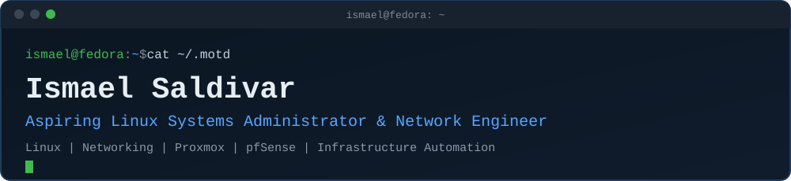
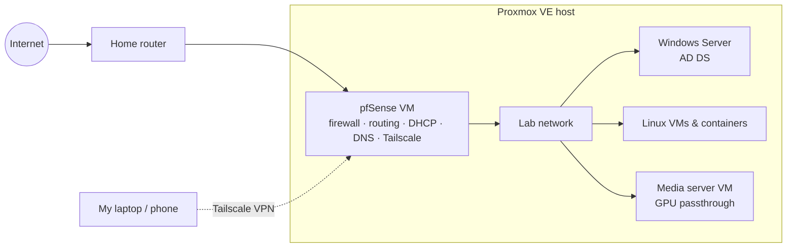

<p align="center">
  <picture>
    <source media="(max-width: 600px)" srcset="assets/header-mobile.svg">
    
  </picture>
</p>

<p align="center">
  <a href="https://www.linkedin.com/in/ismael-saldivar-74a75b112/"></a>
  <a href="https://github.com/Ismael0550/homelab"></a>
  
</p>

```console
ismael@fedora:~$ whoami
Ismael Saldivar
B.S. Computer Science @ UNT, May 2027
Tier 1 IT Support @ Van's Kitchen
Student IT @ UNT College of Engineering

ismael@fedora:~$ uname -a
Linux fedora-kde x86_64 GNU/Linux

ismael@fedora:~$ cat ~/focus.txt
Linux systems administration
Networking and network infrastructure
Virtualization and homelab infrastructure
Infrastructure automation

ismael@fedora:~$ ls ~/projects
homelab/
```
<sub>↑ Illustrative terminal, not live output from a real system.</sub>

## `$ ls /etc/skills`

| Area | How I've actually used it |
|---|---|
| **Linux systems administration** | Fedora KDE as my daily desktop, plus Ubuntu and other distros. Systemd services, journalctl and logs, processes, filesystems and permissions, package management, SSH remote administration, and Linux troubleshooting at work and in my lab |
| **Networking** | pfSense as the router and firewall for my lab: firewall rules, routing, DHCP, and DNS. Tailscale VPN for remote access. Proxmox network bridges and virtual NICs. Network and DNS troubleshooting on the job |
| **Virtualization & homelab** | Proxmox VE running Linux and Windows VMs plus Linux containers. GPU passthrough to a media server VM |
| **Windows Server & Active Directory** | AD Domain Services on Windows Server in my lab. Domain joins, AD administration, and Windows 11 imaging and deployment at work |
| **Infrastructure automation** | FOG Project imaging with automatic AD domain join, and agent deployment through FOG Snapins. ConnectWise RMM. PowerShell and Bash scripting |
| **Programming** | Python, C++, and SQL from coursework and projects. PowerShell and Bash for admin tasks |

<p>
  
  
  
  
  
  
  
  
  
  
  
</p>

## `$ systemctl status homelab`

```console
● homelab.service - Proxmox VE homelab
     Loaded: loaded (/etc/homelab/proxmox-ve)
     Active: active (running) since April 2026
       Docs: https://github.com/Ismael0550/homelab
```
<sub>↑ Illustrative, styled like systemctl output.</sub>

I built my homelab to get hands-on time with the systems I support at work, and with the networking side I don't get to configure there. It's a single **Proxmox VE** server where I build, break, and fix things:

- **Proxmox VE** hosts everything: Linux and Windows VMs, Linux containers, and a media server VM with GPU passthrough
- **pfSense** runs as a VM. It's the router, firewall, DHCP server, and DNS resolver for the lab network, and keeps the lab separate from my home network
- **Windows Server** runs an Active Directory domain I use to practice the AD work I do on the job
- **Linux guests** are where I practice services, permissions, logs, and troubleshooting on server distros
- **Tailscale** runs on pfSense, so I can reach the lab securely when I'm away from home



**What I'm learning from it:** routing and firewall policy, running DHCP and DNS, working behind double NAT, VPN remote access, Proxmox bridges and virtual NICs, PCIe passthrough, and building an AD domain from scratch.

**Full documentation:** [Ismael0550/homelab](https://github.com/Ismael0550/homelab)

## `$ history | grep deploy`

What I do on the job, described without employer configurations or internal details.

**Van's Kitchen, Tier 1 IT Support** (Sep 2026 – present)
- I improved the company's existing **FOG Project** imaging setup on my own. New Windows workstations now **join Active Directory automatically** during deployment.
- Automated endpoint management and security agent deployment with **FOG Snapins**
- Troubleshot image capture failures, permissions, deployment configuration, and Windows provisioning
- Endpoint management with **ConnectWise RMM**, plus day-to-day IT operations

**UNT College of Engineering, Student IT**
- Windows 11 imaging and deployment, **Active Directory** administration, and domain joins
- **Linux and Windows troubleshooting**, plus OS, network, and enterprise application issues for faculty, staff, and computer labs
- PowerShell scripting and software deployment

## `$ ls ~/projects/planned`

These aren't built yet. I'll publish each one when it has real, working content.

| Project | Status | Scope |
|---|---|---|
| `linux-admin-toolkit` | 🟡 planned | Bash scripts and docs for disk and filesystem checks, systemd service status, journalctl log triage, process and resource monitoring, network interface and DNS diagnostics, SSH administration, and system health checks |
| `networking-lab` | 🟡 planned | pfSense, routing, firewall rules, DNS and DHCP, bridges, VPN, troubleshooting, and diagrams, all from my lab |
| `infra-automation` | 🟡 planned | Sanitized lab examples of PowerShell and Bash provisioning, Windows deployment, and AD automation (no employer scripts) |

## `$ ping ismael`

<a href="https://www.linkedin.com/in/ismael-saldivar-74a75b112/"></a>
